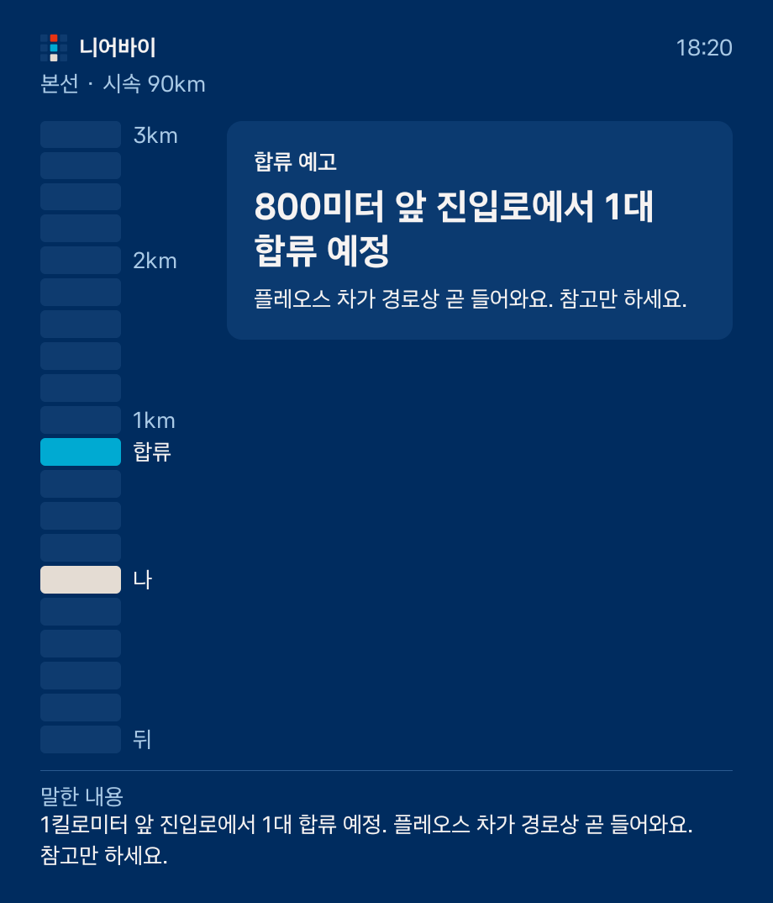
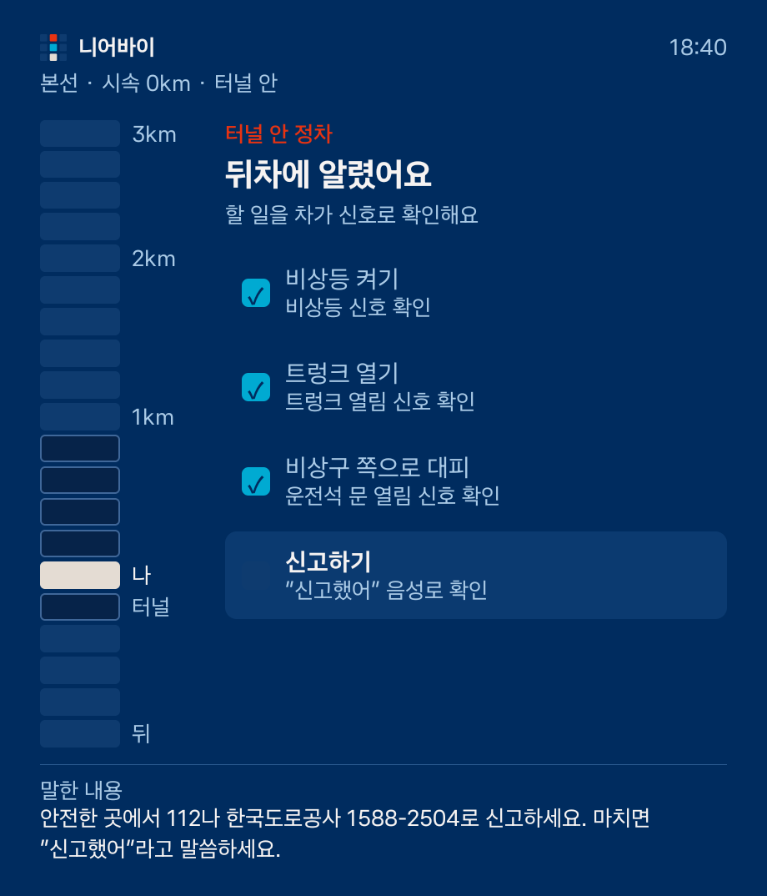
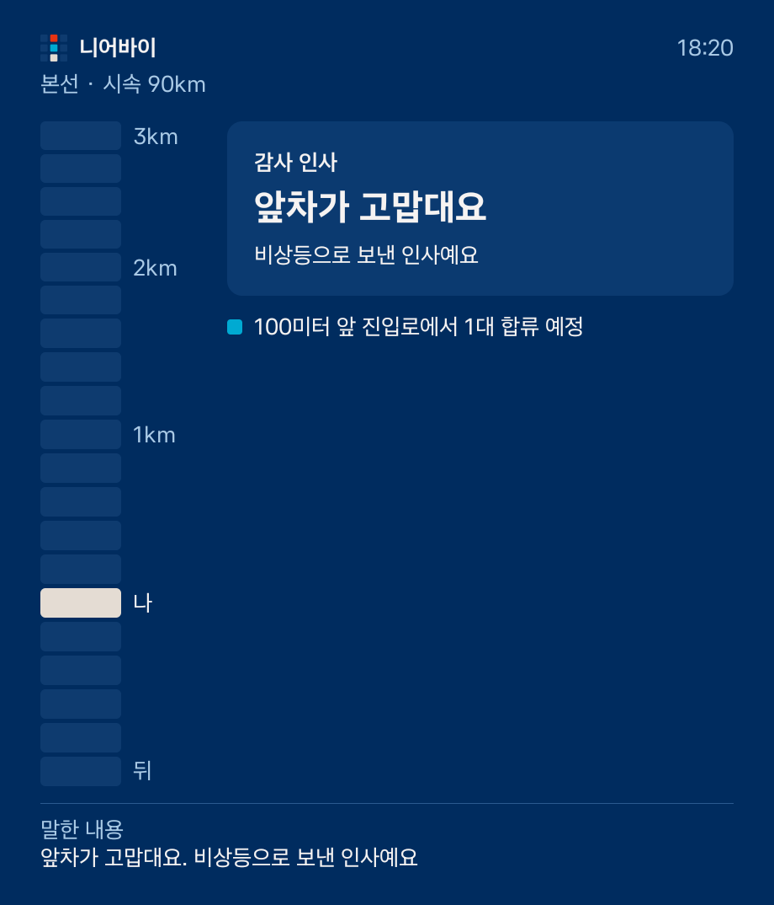
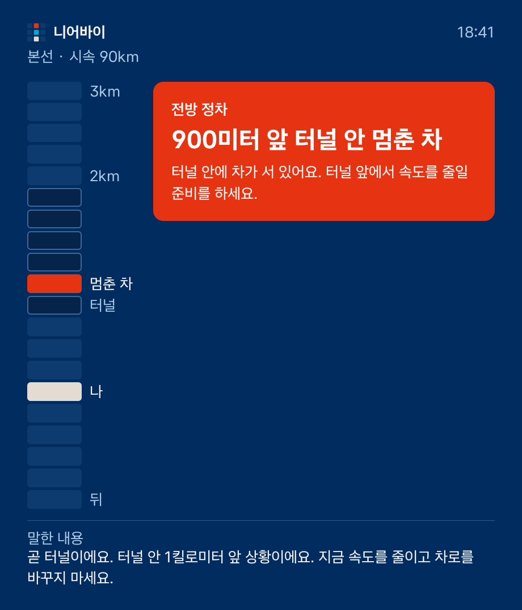
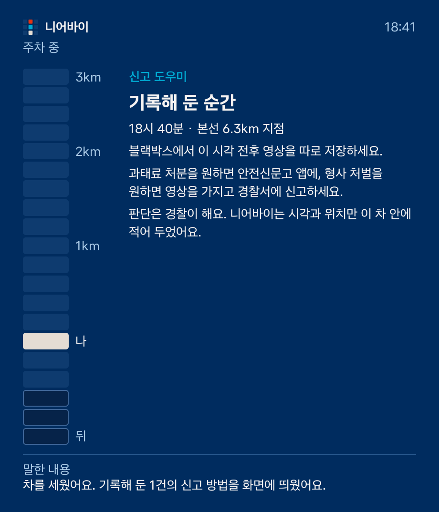
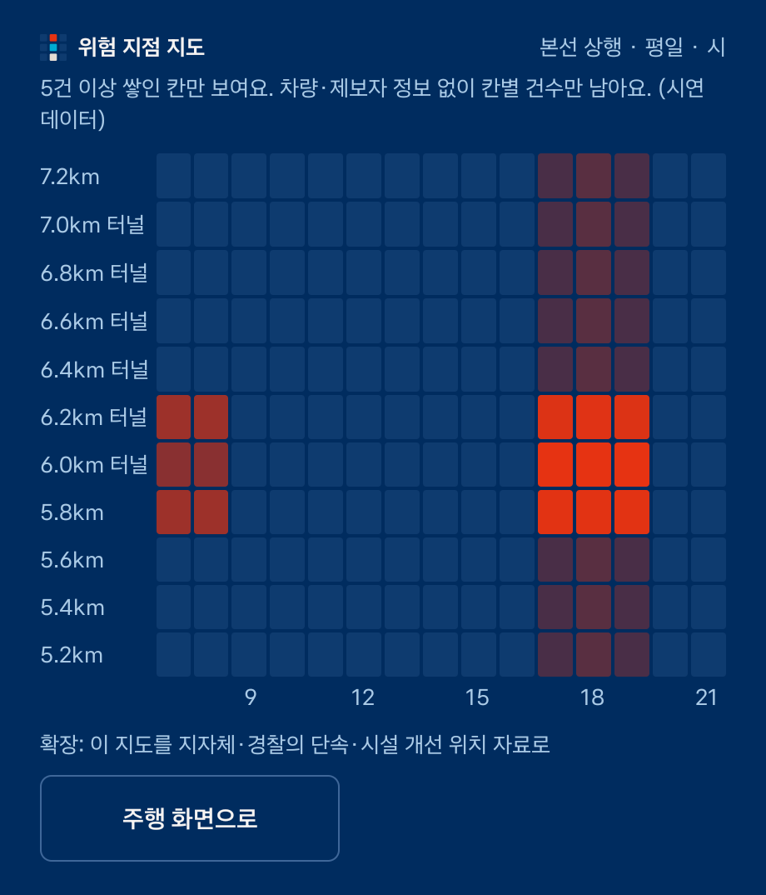
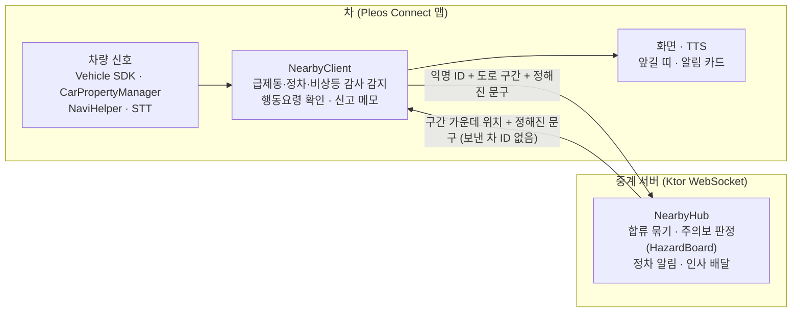

<div align="center">

# 니어바이 (Pleos Nearby)

**근처 플레오스 차끼리 익명으로 나누는 "도로 위 동네 단톡방"**

누가인지는 기억하지 않고, 지금 어느 도로가 위험한지만 나눈다.


  

[APK 받기](apk/봇듀_니어바이_release.apk) · [개발일지](docs/개발일지.md) · [시스템 구조](#시스템-구조) · [시연 방법](#실행)

</div>

> [!NOTE]
> 2026 현대자동차그룹 차량용 앱 개발 공모전 "Code your App into Pleos App Market" 출품작, 팀 봇듀.
> 차량 신호는 아직 시연용 시나리오(차 4대가 같은 도로를 달리는 상황)로 재생한다. Pleos SDK 연결은 [현재 상태](#현재-상태)에 적었다.

## 한눈에 보기

| | |
| --- | --- |
| 무엇을 | 근처 플레오스 차끼리 합류 예정, 위험 구간, 멈춘 차, 짧은 인사를 나눈다 |
| 어떻게 | 앱만으로. 전용 V2X 칩 없이 내비 경로와 차량 신호를 서버로 묶는다 |
| 대표 기능 | **합류 예고**: 진입로 차가 들어오기 수십 초 전에 본선 차가 미리 안다 |
| 하지 않는 것 | 0.1초 단위 안전 제어, 옆 차선 특정 차 지목, 운전 조작 조율 |
| 사생활 | 수시로 바뀌는 익명 ID, 정해진 문구만, 차량 번호·차종·색상은 보낼 칸 자체가 없다 |

## 기능

| 기능 | 무엇을 하나 | 쓰는 신호 |
| --- | --- | --- |
| **A. 합류 예고** ⭐ | 60초 안에 합류할 차가 있으면 본선 차에 "n대 합류 예정", 합류할 차엔 본선 흐름(속도) | NaviHelper 경로·다음 합류 지점 |
| **B. 감사 인사** | "고마워"라고 말하거나, **끼어든 뒤 비상등을 짧게(0.8~4초) 켜면** 바로 뒤 150m 안 차에 감사 문구 | STT, Light(비상등), TurnSignal |
| **C. 문제 알림** | "앞차 주유구 열렸어" → 바로 앞 100m 안 차에 정해진 문구 | STT |
| **D-1. 사고 정차 경고** ⭐ | 급제동 뒤 멈추면 뒤 2km(터널 3km) 차에 알리고, 멈춘 차엔 **행동요령을 차량 신호로 하나씩 확인** | Brake·속도, Light, Door(트렁크·문) |
| **D-2. 앞길 주의보** ⭐ | 같은 구간에서 30초 안에 **서로 다른 차 2대**의 신호(급제동·음성 제보)가 모이면 뒤 2km엔 전방 주의, 앞 1km엔 후방 주의. 5분 뒤 소멸 | Brake·속도, STT |
| **D-2+. 터널 앞 경고** | 주의보가 터널 안이면 뒤 3km까지 넓히고, 터널 1km 앞에서 한 번 더 말한다 | NaviHelper 터널 안내 |
| **D-3. 신고 도우미** | "신고해줘" → 시각·위치를 이 차 안에만 적고, 세운 뒤 블랙박스·안전신문고 안내 | STT, 기어 P |
| **위험 지점 지도** | 같은 칸(구간 × 요일 × 시)에 5건 이상 쌓인 곳만 칠한다 | 주의보 통계(건수만) |

### 이미 있는 것과 무엇이 다른가

비슷한 서비스가 이미 있는 기능도 빼지 않고, 그보다 한 걸음 더 가게 만들었다.

| 이미 있는 것 | 니어바이가 더하는 것 |
| --- | --- |
| 티맵 V2X 전방 급정거 알림(2018), 갓길 정차 알림, 사고포착알리미(2021, 뒤 2km) | 한 대의 급제동으로 바로 퍼뜨리지 않고 **2대 이상 겹칠 때만** 주의보. **앞쪽 차에도 후방 주의**. 멈춘 차에겐 경고에서 끝나지 않고 **행동요령을 차량 신호로 확인**. 터널이면 범위와 재안내를 따로 둔다. 별도 내비 앱 없이 순정 화면에서 |
| 경쟁작 '퍼스트30'(사고 직후 30초 할 일 안내) | 안내를 읽어 주는 데서 그치지 않고, 비상등·트렁크·문 신호로 **이미 한 단계는 건너뛰고 남은 것만** 말한다 |
| 경쟁작 Pixel TMI·길동무·와이퍼넷(근처 차끼리 정보 공유) | 정해진 문구만 오가고(자유 텍스트 없음), 다른 차에게 가는 말엔 보낸 차의 익명 ID도 없다. 합류 예고처럼 **내비 경로를 미리 나누는 기능**은 찾지 못했다 |

## 차 안에서 이렇게 보인다

<table>
<tr>
<td width="33%"></td>
<td width="33%"></td>
<td width="33%"></td>
</tr>
<tr>
<td><b>합류 예고</b> (본선 차 B)<br>왼쪽 앞길 띠에 합류 지점이 파란 칸으로 뜬다</td>
<td><b>감사 인사</b> (차 B)<br>합류한 A가 비상등을 짧게 켜자 "앞차가 고맙대요"</td>
<td><b>문제 알림</b> (차 A)<br>뒤차 B가 "앞차 트렁크 열렸어"라고 말해 줌</td>
</tr>
<tr>
<td></td>
<td></td>
<td></td>
</tr>
<tr>
<td><b>앞길 주의보</b> (터널 2km 뒤 차 D)<br>B·C가 거의 동시에 급제동 → 2점 → 터널 안 주의보</td>
<td><b>행동요령 확인</b> (멈춘 차 C)<br>비상등·트렁크·문 신호로 체크, 남은 "신고"만 안내</td>
<td><b>터널 앞 재안내</b> (차 D)<br>정차 알림으로 바뀌고, 터널 1km 앞에서 한 번 더</td>
</tr>
<tr>
<td></td>
<td></td>
<td></td>
</tr>
<tr>
<td><b>후방 주의</b> (앞서 가는 차 A)<br>누구인지 몰라도 방향과 시간만으로 대비</td>
<td><b>신고 도우미</b> (차 B, 주차 후)<br>"신고해줘"라고 말한 순간을 돌려준다</td>
<td><b>위험 지점 지도</b><br>평일 저녁 터널 입구에 제보가 몰린다 (시연 데이터)</td>
</tr>
</table>

<sub>Pleos Connect 앱 창 크기(세로 1칸 920×1330)로 맞춘 에뮬레이터에서 찍은 실제 실행 화면. 아래쪽 시연 조작판은 잘랐다(<a href="docs/screens/0_demo.png">조작판 포함 화면</a>).</sub>

## 판정 규칙

| 규칙 | 값 | 이유 |
| --- | --- | --- |
| 도로 구간 | 200m | 차선이 아니라 구간 단위라 일반 GPS로 충분 |
| 급제동 | 브레이크 + 1.5초 안 3.5m/s² 이상 감속, 시속 30km 이상에서 | 보험사 급감속 기준(약 0.35g) 근처. 에뮬레이터 실험으로 다듬을 값 |
| 정차 | 급제동 뒤 30초 안에 멈춰 10초, 또는 비상등 켜고 10초 | 신호 대기와 구분 |
| 주의보 | 같은 구간(또는 바로 옆 구간)·같은 방향, 30초 안, 서로 다른 차 2대 | "증인 두 명" 규칙. 한 사람의 감정적 제보로는 안 퍼진다 |
| 알림 범위 | 뒤 2km(터널 3km) 전방 주의, 앞 1km 후방 주의 | 터널은 피할 곳이 없다 |
| 소멸 | 5분 (새 신호가 오면 연장) | 순간과 장소만 기억 |
| 비상등 감사 | 0.8~4초 켬, 시속 20km 이상, 깜빡이 켠 지 20초 안 | 4초 넘게 켜거나 서 있을 때는 진짜 비상 |
| 감사·문제 알림 대상 | 바로 뒤 150m / 바로 앞 100m 안 가장 가까운 한 대 | 받을 차가 없으면 "전하지 못했어요"라고 솔직히 말한다 |
| 음성 제보 | 1분에 1번, 하루 10번 (기기 안에서만 셈) | 남용 방지 |
| 익명 ID | 10분마다 바뀜 (멈춘 동안은 유지) | 서버도 한 차를 오래 따라갈 수 없다 |
| 지도 표시 | 같은 칸 5건 이상 | 드문 제보로 특정 시각·장소가 드러나지 않게 |

## 시스템 구조



```text
core/    차와 서버가 함께 쓰는 판정 규칙·통신 형식 (Kotlin JVM, 안드로이드 의존 없음)
  Protocol.kt        차 ↔ 서버 메시지. 자유 텍스트·차량 번호·차종·색상 칸이 없다
  NearbyHub.kt       서버 판단: 합류 예고, 주의보 퍼뜨리기, 정차 알림, 감사·문제 배달
  HazardBoard.kt     주의보 판정(2대 규칙·5분 소멸)과 지도용 건수 통계
  Detectors.kt       급제동·정차·비상등 감사 감지
  SafetyChecklist.kt 2차 사고 행동요령을 차량 신호로 확인
  NearbyClient.kt    차 한 대: 신호 → 서버로 보낼 것, 서버 말 → 화면·음성
  demo/              시연 시나리오 2편과 재생기
server/  Ktor WebSocket 중계 서버. 판단은 core에 맡기고 연결만 관리
app/     Pleos Connect 앱 (Jetpack Compose)
```

`NearbyHub`를 통신과 떼어 두어서, 같은 판단을 **앱 안(한 대 시연)** 과 **진짜 서버(여러 대 시연)** 에서 그대로 돌린다.

## 실행

### 한 대 시연 (에뮬레이터 1대)

APK를 설치하고 실행한 뒤 **시연 1 합류** 또는 **시연 2 터널**을 고르고 **재생**. 아래 **차 A~D**를 누르면 같은 순간을 다른 차의 화면으로 본다. 시연 2가 끝나면 **5분 뒤로**로 주의보가 사라지는 걸 보고, **위험 지점 지도**를 연다.

### 여러 대 시연 (에뮬레이터 여러 대 + 내 PC 서버)

```bash
NEARBY_DEMO=1 ./gradlew :server:run          # ws://localhost:8080/nearby
```

에뮬레이터마다 **여러 대 시연**을 켜고 맡을 차(A~D)를 고른 뒤 함께 **재생**한다. 에뮬레이터는 `10.0.2.2:8080`으로 PC 서버에 붙는다(주소는 `app/build.gradle.kts`의 `HUB_URL`).

### 원하는 장면에서 바로 열기 (화면 캡처·영상용)

```bash
adb shell am start -n com.botdue.nearby/.MainActivity --ei scenario 1 --es car D --ei seek 12
```

### 빌드와 테스트

```bash
./gradlew :core:test :server:test   # 테스트 26개
./gradlew :app:assembleRelease
```

## 현재 상태

| 항목 | 상태 |
| --- | --- |
| 판정 엔진(core) | 완료, 테스트 25개 (규칙별 + 시나리오 처음부터 끝까지) |
| 중계 서버 | 완료, WebSocket 두 연결 간 배달 테스트 1개. 에뮬레이터 앱 ↔ PC 서버 ↔ 다른 차(스크립트) 합류 예고 오가는 것 확인 |
| 차량 앱 화면 | 완료 (주행·행동요령·신고 도우미·지도). 휴대폰 에뮬레이터를 Pleos 창 크기로 맞춰 확인, Pleos 이미지에서는 아직 |
| Pleos SDK 연결 | 예정. `VehicleSample`을 Vehicle SDK(Brake·TurnSignal·Light·Door), CarPropertyManager(속도·기어), NaviHelper(경로·합류 지점·터널) 콜백으로 채운다 |
| 음성 | 예정. 지금은 낱말 규칙(`KeywordIntentReader`), Gleo AI STT·LLM으로 바꾼다 |
| 확인할 것 | Sync SDK로 다른 사용자 차끼리 공유 가능한지(안 되면 지금 서버 유지), NaviHelper로 다음 합류 지점 받기, 비상등 상태 읽기, 급제동 기준값 |

## 지키는 원칙

- 판단은 운전자가 한다. 니어바이는 "참고 정보"만 준다.
- 알림은 한 번, 짧고 차분하게. 터널 앞 재안내만 예외.
- 특정 차·사람을 기억하지 않는다. 순간과 장소만, 5분 동안.
- 신고 판단은 경찰이 한다. 앱은 시각·위치 메모와 절차 안내만.

## 근거

| 내용 | 출처 |
| --- | --- |
| 고속도로 2차 사고 치사율 약 44%, 전체 사고의 약 4배 | [인사이트](https://www.insight.co.kr/news/539886), [헤럴드경제 2026.07](https://www.heraldk.com/article/2026070714003108803) |
| 터널 사고 3대 이상 연쇄 추돌 44.9% (전체 고속도로 35.5%), 2021~2025 | [SBS Biz (한국도로공사 자료)](https://biz.sbs.co.kr/amp/article/20000334257) |
| 보복운전 검찰 송치 2022년 1,570건 → 2025년 1,726건 | [다음 뉴스](https://v.daum.net/v/Bl0WyJXSHP) |
| 티맵 V2X 급정거·갓길 정차 알림, 사고포착알리미 | [SKT 뉴스룸](https://news.sktelecom.com/132635), [스포츠경향 2021.05](https://sports.khan.co.kr/article/202105241416013) |
| 비상등 패턴을 뒤차에 전하는 연구(앱 없음) | [koreascience](https://koreascience.or.kr/article/JAKO202018955008656.page) |
| 협력 차선 변경·합류 표준화(전용 V2X 칩 필요) | [ETSI TR 103 578](https://www.etsi.org/deliver/etsi_tr/103500_103599/103578/02.01.01_60/tr_103578v020101p.pdf) |

---

<sub>팀 봇듀 · 2026 현대자동차그룹 차량용 앱 개발 공모전</sub>
