<div align="center">

# 니어바이 (Pleos Nearby)

**근처 플레오스 차끼리 익명으로 나누는 "도로 위 동네 단톡방"**

누가인지는 기억하지 않고, 지금 어느 도로가 위험한지만 나눈다.


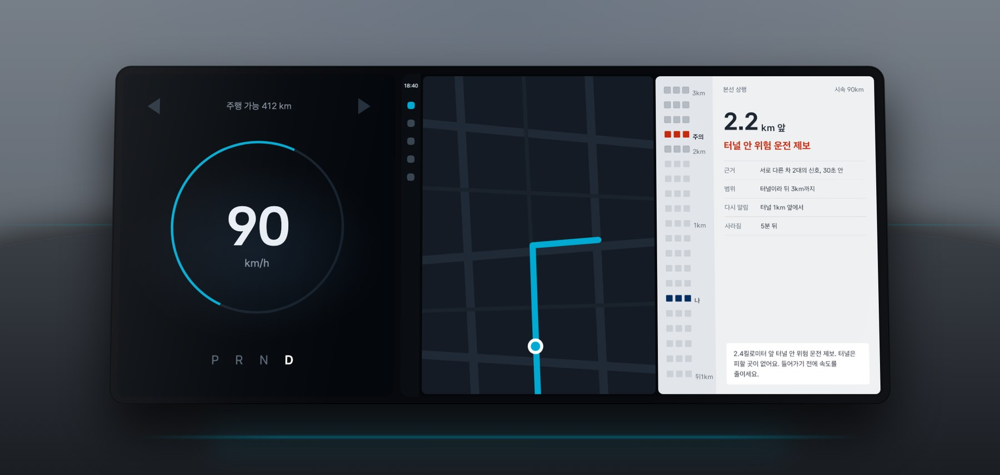

[움직이는 장면](#움직이는-장면) · [**시연 영상 (83초)**](docs/demo.mp4) · [APK 받기](apk/봇듀_니어바이_release.apk) · [개발일지](docs/개발일지.md) · [시스템 구조](#시스템-구조) · [시연 방법](#실행)

</div>

> [!NOTE]
> 2026 현대자동차그룹 차량용 앱 개발 공모전 "Code your App into Pleos App Market" 출품작, 팀 봇듀.
> 차량 신호는 아직 시연용 시나리오(차 4대가 같은 도로를 달리는 상황)로 재생한다. Pleos SDK 연결은 [현재 상태](#현재-상태)에 적었다.

## Pleos Connect 에뮬레이터에서 실제로 실행한 화면

**Pleos Connect Emulator v2.1.0**(2560×1440, 160dpi)에 release APK를 설치해 실행한 전체 화면이다. 왼쪽은 Pleos 차량 상태, 가운데가 니어바이(세로 1칸), 오른쪽은 Pleos 지도. 가로 2칸은 지도 자리까지 펼친 화면이다. 차량 신호는 아직 시연용 데이터로 재생한다.

<table>
<tr><td width="50%">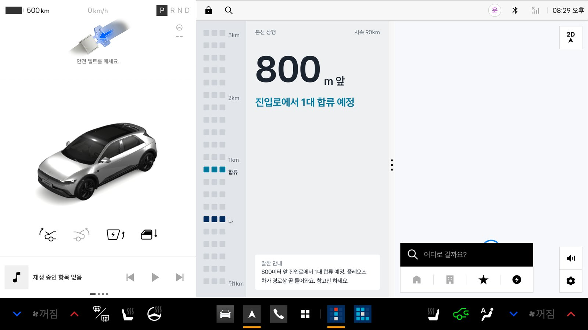</td><td width="50%">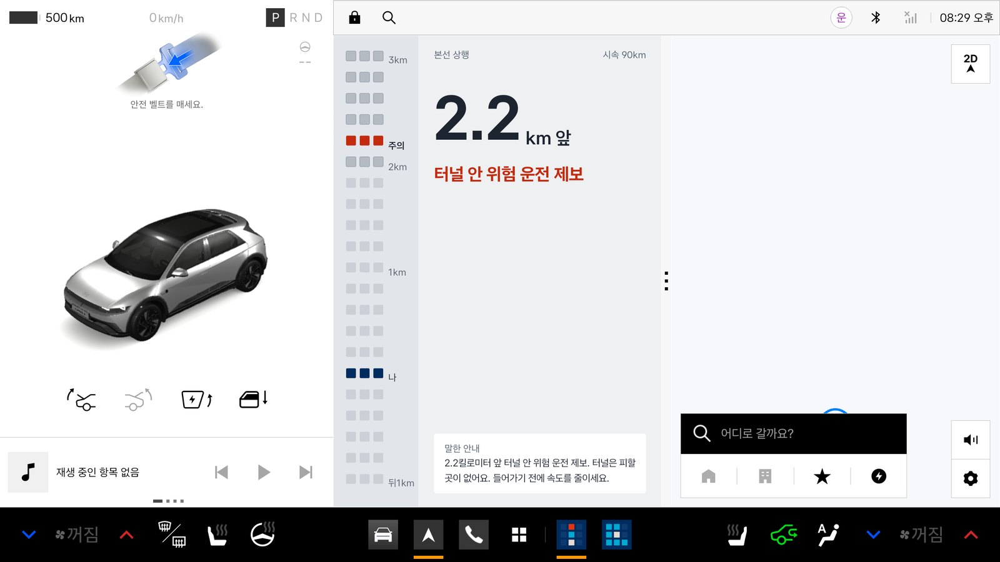</td></tr>
<tr><td><b>합류 예고</b></td><td><b>터널 안 앞길 주의보</b></td></tr>
<tr><td width="50%">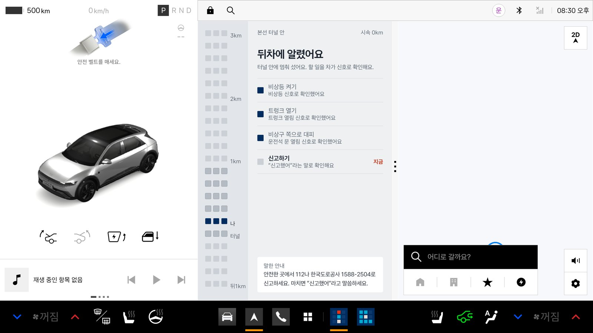</td><td width="50%">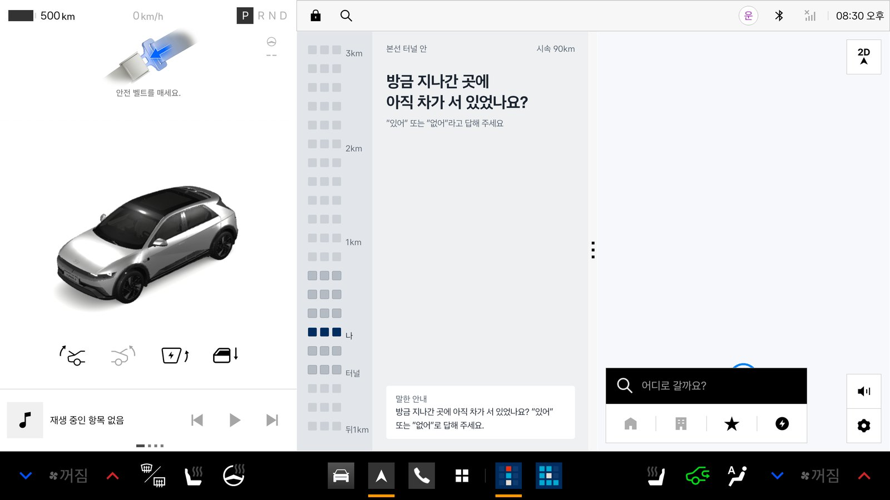</td></tr>
<tr><td><b>멈춘 차 행동요령 확인</b></td><td><b>지나간 뒤 확인</b></td></tr>
</table>

## 한눈에 보기

| | |
| --- | --- |
| 무엇을 | 근처 플레오스 차끼리 합류 예정, 위험 구간, 멈춘 차, 짧은 인사를 나눈다 |
| 어떻게 | 앱만으로. 전용 V2X 칩 없이 내비 경로와 차량 신호를 서버로 묶는다 |
| 대표 기능 | **합류 예고**: 진입로 차가 들어오기 수십 초 전에 본선 차가 미리 안다 |
| 하지 않는 것 | 0.1초 단위 안전 제어, 옆 차선 특정 차 지목, 운전 조작 조율 |
| 사생활 | 수시로 바뀌는 익명 ID, 정해진 문구만, 차량 번호·차종·색상은 보낼 칸 자체가 없다 |

## 기능

| 기능 | 무엇을 하나 | 쓰는 신호 |
| --- | --- | --- |
| **A. 합류 예고** ⭐ | 60초 안에 합류할 차가 있으면 본선 차에 "n대 합류 예정", 합류할 차엔 본선 흐름(속도) | NaviHelper 경로·다음 합류 지점 |
| **B. 감사 인사** | "고마워"라고 말하거나, **끼어든 뒤 비상등을 짧게(0.8~4초) 켜면** 바로 뒤 150m 안 차에 감사 문구. 정체 중에는 더 엄격하게 본다([비상등 감사 판정](#비상등-감사-판정)) | STT, Light(비상등), TurnSignal, Brake, 기어 |
| **C. 문제 알림** | "앞차 주유구 열렸어" → 바로 앞 100m 안 차에 정해진 문구 | STT |
| **D-1. 사고 정차 경고** ⭐ | 급제동 뒤 멈추면 뒤 2km(터널 3km) 차에 알리고, 멈춘 차엔 **행동요령을 차량 신호로 하나씩 확인**. 뒤차는 500m 앞에서 한 번 더 듣고, **지나간 뒤 "아직 서 있었나요?"에 답해** 알림을 이어 두거나 지운다([뒤차가 지나간 뒤](#d-1-뒤차가-지나간-뒤)) | Brake·속도, Light, Door(트렁크·문), STT |
| **D-2. 앞길 주의보** ⭐ | 같은 구간에서 30초 안에 **서로 다른 차 2대**의 신호(급제동·음성 제보)가 모이면 뒤 2km엔 전방 주의, 앞 1km엔 후방 주의. 5분 뒤 소멸 | Brake·속도, STT |
| **D-2+. 터널 앞 경고** | 주의보가 터널 안이면 뒤 3km까지 넓히고, 터널 1km 앞에서 한 번 더 말한다 | NaviHelper 터널 안내 |
| **D-3. 신고 도우미** | "신고해줘" → 시각·위치를 이 차의 앱 안에만 적고, 세운 뒤 블랙박스·안전신문고 안내 | STT, 기어 P |
| **위험 지점 지도** | 같은 칸(구간 × 요일 × 시)에 5건 이상 쌓인 곳만 칠한다 | 주의보 통계(건수만) |

### 이미 있는 것과 무엇이 다른가

비슷한 서비스가 이미 있는 기능도 빼지 않고, 그보다 한 걸음 더 가게 만들었다.

| 이미 있는 것 | 니어바이가 더하는 것 |
| --- | --- |
| 티맵 V2X 전방 급정거 알림(2018), 갓길 정차 알림, 사고포착알리미(2021, 뒤 2km) | 한 대의 급제동으로 바로 퍼뜨리지 않고 **2대 이상 겹칠 때만** 주의보. **앞쪽 차에도 후방 주의**. 멈춘 차에겐 경고에서 끝나지 않고 **행동요령을 차량 신호로 확인**. 터널이면 범위와 재안내를 따로 둔다. 별도 내비 앱 없이 순정 화면에서 |
| 티맵 소셜 제보(2026.05), 카카오내비×한국도로공사 국민 교통안전이음(2026.07) | 운전자가 따로 제보하지 않아도 급제동·정차를 차량 신호로 잡는다. 멈춘 차 옆을 **지나간 뒤차의 "있어/없어" 한마디**로 정차 알림을 이어 두거나 지운다(알림을 받은 차의 답만 센다) |
| 경쟁작 '퍼스트30'(사고 직후 30초 할 일 안내) | 안내를 읽어 주는 데서 그치지 않고, 비상등·트렁크·문 신호로 **이미 한 단계는 건너뛰고 남은 것만** 말한다 |
| 경쟁작 Pixel TMI·길동무·와이퍼넷(근처 차끼리 정보 공유) | 정해진 문구만 오가고(자유 텍스트 없음), 다른 차에게 가는 말엔 보낸 차의 익명 ID도 없다. 합류 예고처럼 **내비 경로를 미리 나누는 기능**은 찾지 못했다 |

## 차 안에서 이렇게 보인다

<table>
<tr>
<td width="33%"></td>
<td width="33%"></td>
<td width="33%">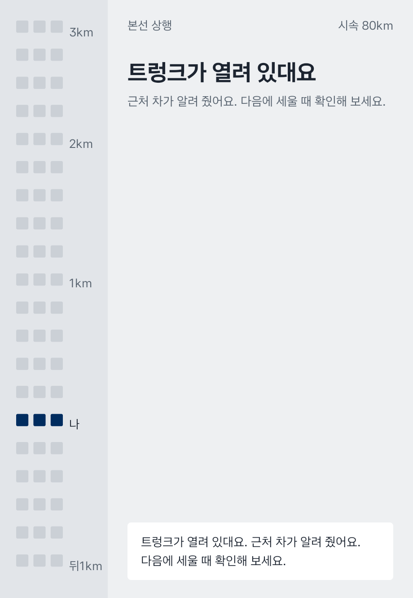</td>
</tr>
<tr>
<td><b>합류 예고</b> (본선 차 B)<br>왼쪽 앞길 램프에 합류 지점이 파란 칸으로, 오른쪽엔 남은 거리가 크게</td>
<td><b>감사 인사</b> (차 B)<br>합류한 A가 비상등을 짧게 켜자 "앞차가 고맙대요"</td>
<td><b>문제 알림</b> (차 A)<br>뒤차 B가 "앞차 트렁크 열렸어"라고 말해 줌</td>
</tr>
<tr>
<td>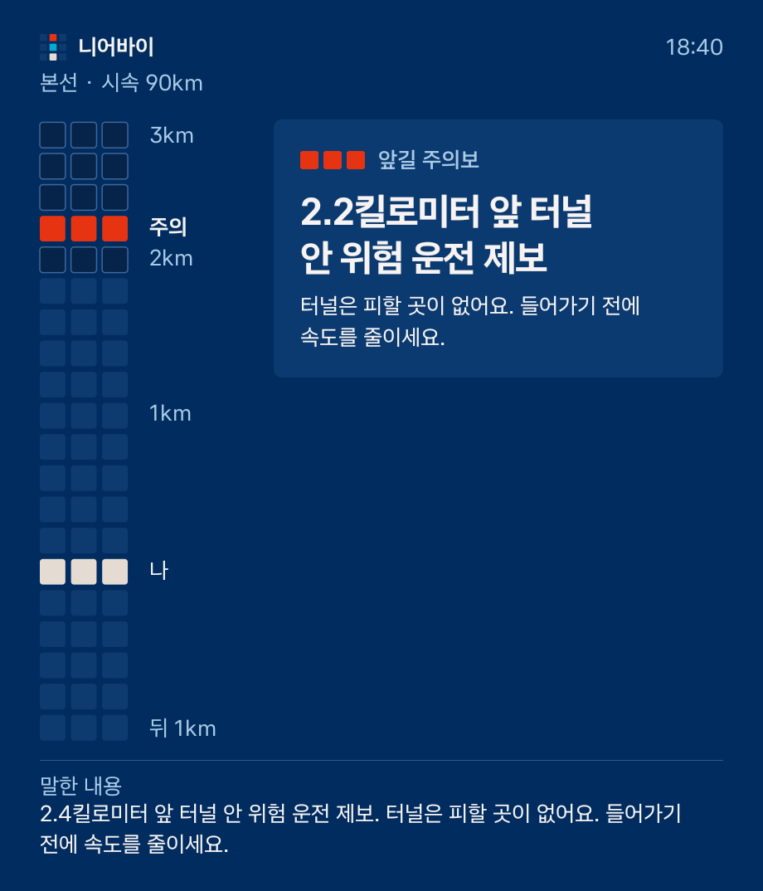</td>
<td></td>
<td></td>
</tr>
<tr>
<td><b>앞길 주의보</b> (터널 2km 뒤 차 D)<br>B·C가 거의 동시에 급제동 → 서로 다른 차 2대 → 터널 안 주의보</td>
<td><b>행동요령 확인</b> (멈춘 차 C)<br>비상등·트렁크·문 신호로 체크, 남은 "신고"만 안내</td>
<td><b>터널 앞 재안내</b> (차 D)<br>정차 알림으로 바뀌고, 터널 1km 앞에서 한 번 더</td>
</tr>
<tr>
<td>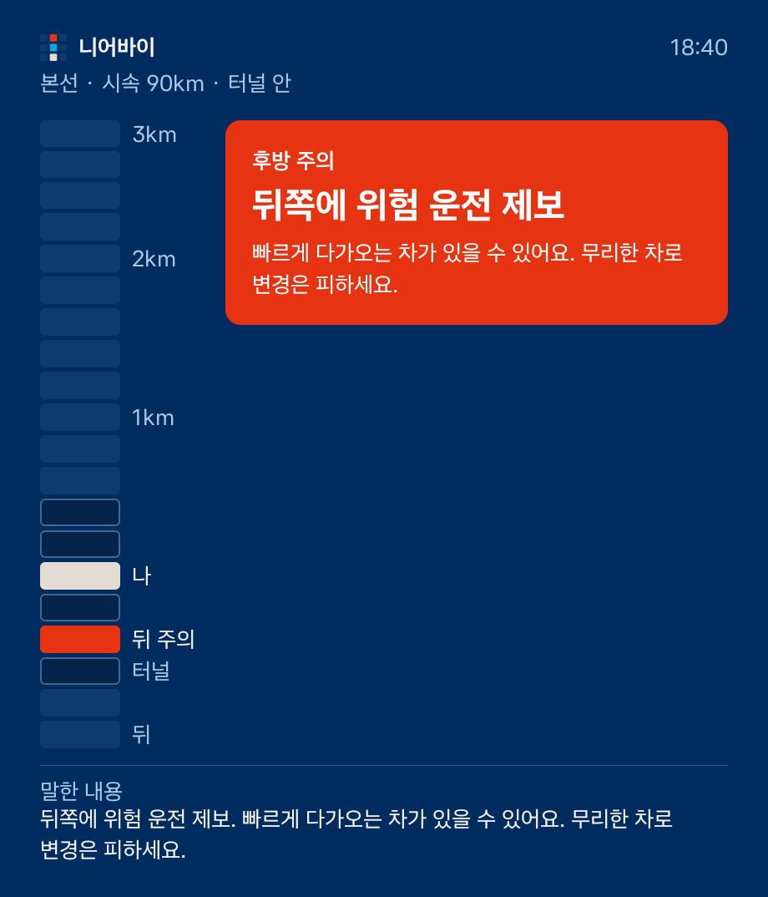</td>
<td></td>
<td></td>
</tr>
<tr>
<td><b>후방 주의</b> (앞서 가는 차 A)<br>누구인지 몰라도 방향과 시간만으로 대비</td>
<td><b>신고 도우미</b> (차 B, 주차 후)<br>"신고해줘"라고 말한 순간을 돌려준다</td>
<td><b>위험 지점 지도</b><br>평일 저녁 터널 입구에 제보가 몰린다 (시연 데이터, 지자체·경찰 위치 자료로 확장 가능)</td>
</tr>
<tr>
<td>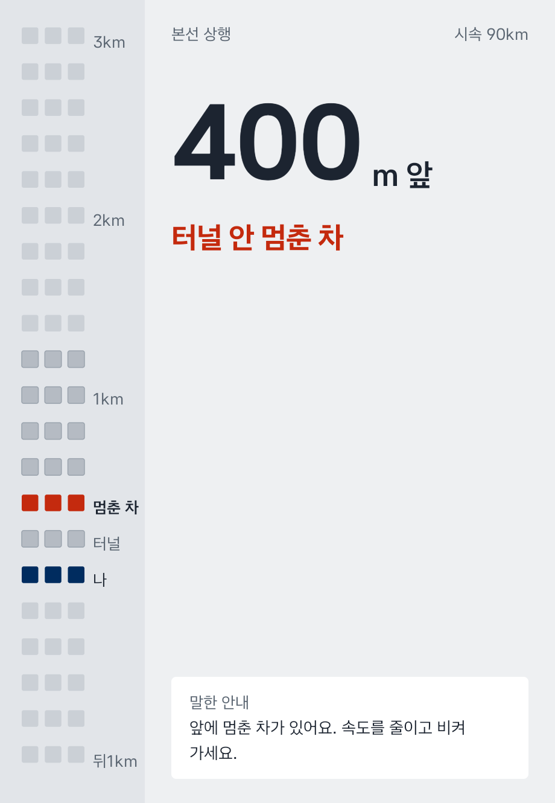</td>
<td>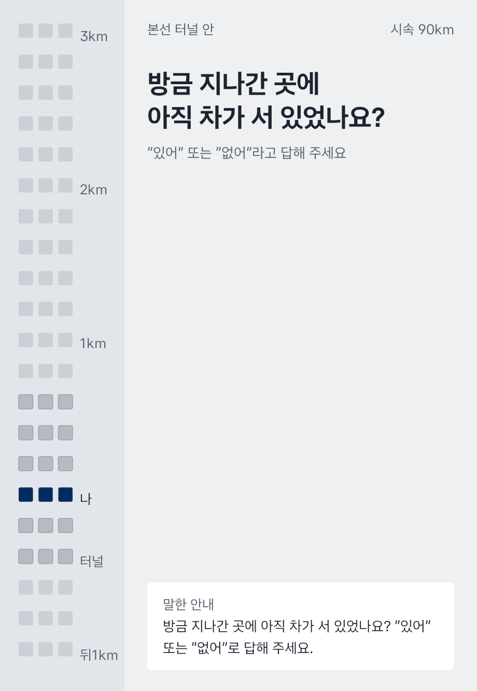</td>
<td>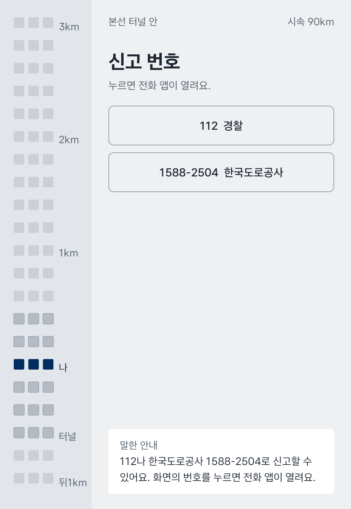</td>
</tr>
<tr>
<td><b>멈춘 차 앞 재안내</b> (뒤차 D)<br>500m 앞에서 "속도를 줄이고 비켜 가세요" 한 번 더</td>
<td><b>지나간 뒤 확인</b> (뒤차 D)<br>"아직 서 있었나요?"에 "있어/없어" → 뒤차 알림을 이어 두거나 지운다</td>
<td><b>신고 번호</b> (뒤차 D)<br>원하면 112·1588-2504. 누르면 전화 앱만 열리고, 멈추라고는 하지 않는다</td>
</tr>
<tr>
<td>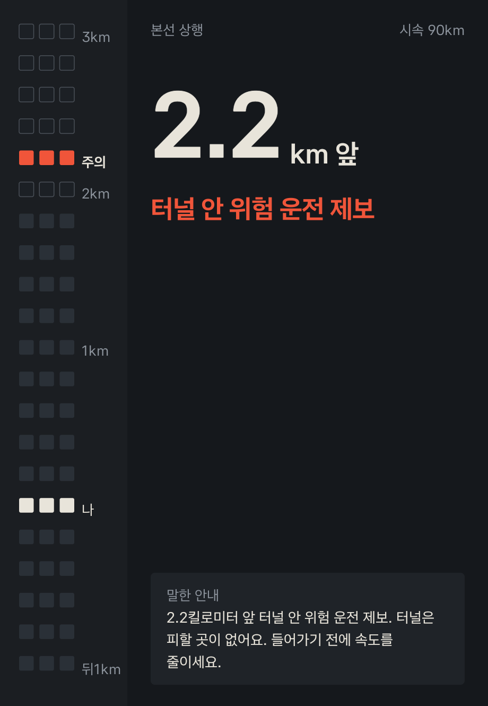</td>
<td colspan="2" valign="top"><b>야간</b><br>차의 야간 모드를 따라 바탕이 어두워진다. 위험은 같은 빨강, 내 줄은 밝은 칸.<br><br>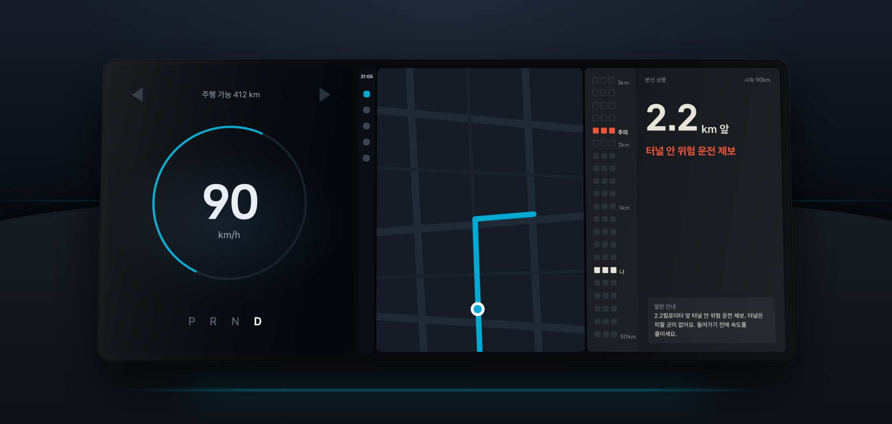</td>
</tr>
</table>

<sub>Pleos Connect 앱 창 크기(세로 1칸 920×1330)로 맞춘 에뮬레이터에서 찍은 실제 실행 화면(v0.3.0). 시연 조작판은 숨기고 찍었다(<a href="docs/screens/0_demo.png">조작판 포함 화면</a>).</sub>

### 움직이는 장면

<table>
<tr>
<td width="45%">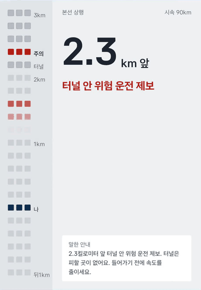</td>
<td>
<b>시연 2 · 터널 2km 뒤 차 D (13초)</b><br><br>
1. 터널 안에서 앞차 둘이 거의 동시에 급제동하면 주의보가 생긴다.<br>
2. 내 줄에서 위험 지점까지 픽셀이 한 번 차례로 켜졌다 꺼진다. 거리를 눈으로 보여 주는, 이 앱의 유일한 움직임이다.<br>
3. 그중 한 대가 멈춰 서면 더 급한 "멈춘 차" 알림 하나로 바뀐다.<br><br>
<sub>에뮬레이터 실제 화면(v0.3.0)을 녹화했다. 시연 조작판은 숨겼다.</sub>
</td>
</tr>
</table>

## 디자인

현대차 아이오닉 램프 캠페인 "Pixel by Pixel"(2023)의 한 문장에서 출발했다: *픽셀 하나는 깜빡일 뿐이지만, 모이면 더 큰 것이 된다.* 니어바이에서 픽셀 하나는 도로 200m이고, 모이면 길이 된다.

네 앱이 같은 차 안에서 같은 앱처럼 보이지 않도록 화면 문법부터 나눴다. 니어바이는 **밝은 도로 위 램프와 표지판**이다.

- **밝은 도로**: 바탕은 낮 도로의 연회색(#EEF0F2). 다른 세 앱이 남색·하늘색·연녹색이라, 같은 차에서 켜도 바로 구분된다.
- **앞길 램프**: 왼쪽 기둥은 파라메트릭 픽셀처럼 네모 칸을 쌓은 램프다. 한 줄이 200m, 위가 앞쪽이다. 1km·2km·3km 이름표는 5줄 간격으로 똑같이 붙는다. 내 줄은 남색, 위험은 Active Red, 합류는 Active Blue로 켜지고 다른 차의 위치는 그리지 않는다.
- **표지판처럼 읽히는 알림**: 달리는 중에는 "2.3 km 앞" 거리 숫자를 가장 크게, 그 아래 무엇인지 한 줄, 맨 아래 흰 칸에 말한 안내만. 근거·범위·다시 알림·사라짐 표는 기어 P이거나 알림을 눌렀을 때만 펼친다. 말한 안내 속 거리는 지금 남은 거리로 맞춰 위의 큰 숫자와 어긋나지 않게 한다.
- **움직임은 하나만**: 새 알림이 오면 내 줄에서 그 지점까지 픽셀이 한 번 차례로 켜졌다 꺼진다. 거리를 눈으로 보여 주는 용도다.
- 색은 현대차 CI(Hyundai Blue, Active Red, Active Blue).
- 서체는 Asta Sans(42dot, OFL). 현대차 광고에 쓰이는 Hyundai Sans는 배포할 수 없는 전용 서체라, Pleos가 쓰는 같은 계열 공개 서체로 네 앱을 통일했다. 한국어는 어절 단위로만 줄을 바꾼다(`WordBreak.Phrase`).

## 판정 규칙

| 규칙 | 값 | 이유 |
| --- | --- | --- |
| 도로 구간 | 200m | 차선이 아니라 구간 단위라 일반 GPS로 충분 |
| 급제동 | 브레이크 + 1.5초 안 3.5m/s² 이상 감속, 시속 30km 이상에서 | 보험사 급감속 기준(약 0.35g) 근처. 에뮬레이터 실험으로 다듬을 값 |
| 정차 | 급제동 뒤 30초 안에 멈춰 10초, 또는 비상등 켜고 10초 | 신호 대기와 구분 |
| 주의보 | 같은 구간(또는 바로 옆 구간)·같은 방향, 30초 안, 서로 다른 차 2대 | "증인 두 명" 규칙. 한 사람의 감정적 제보로는 안 퍼진다 |
| 알림 범위 | 뒤 2km(터널 3km) 전방 주의, 앞 1km 후방 주의 | 터널은 피할 곳이 없다 |
| 소멸 | 5분 (새 신호가 오면 연장) | 순간과 장소만 기억 |
| 비상등 감사 | 깜빡이 뒤 20초 안, 0.8~4초 켬 (정체 중엔 3초까지 + 10초 지켜봄) | [아래 표](#비상등-감사-판정) |
| 정차 알림 유지·삭제 | 지나간 뒤차의 "있어" → 그때부터 10분 유지. "없어" 서로 다른 차 2표 + 멈춘 차 신호 10초 끊김 → 삭제 | 알림을 받은 차의 답만 센다. 지우는 쪽은 사람 답으로만 |
| 감사·문제 알림 대상 | 바로 뒤 150m / 바로 앞 100m 안 가장 가까운 한 대 | 받을 차가 없으면 "전하지 못했어요"라고 솔직히 말한다 |
| 음성 제보 | 1분에 1번, 하루 10번 (기기 안에서만 셈) | 남용 방지 |
| 익명 ID | 10분마다 바뀜 (멈춘 동안은 유지) | 서버도 한 차를 오래 따라갈 수 없다 |
| 지도 표시 | 같은 칸 5건 이상 | 드문 제보로 특정 시각·장소가 드러나지 않게 |

### 비상등 감사 판정

원칙: **감사를 놓치는 것은 괜찮지만, 진짜 비상을 감사로 잘못 읽지 않는다.** 정체 구간에서 끼어든 뒤 멈춰 서서 켜는 비상등도 감사일 수 있지만, 앞이 막혀 켜는 비상등과 섞이기 쉬워 더 엄격하게 본다.

| 조건 | 달리는 중 (시속 20km 이상) | 정체·정차 (켠 동안 한 번이라도 20km 미만) |
| --- | --- | --- |
| 끼어듦 | 깜빡이를 켰다 끈 뒤 20초 안에 비상등을 켬 | 같음 |
| 켠 시간 | 0.8~4초 | 0.8~**3초** |
| 급제동 | 켜기 전 30초 안·켠 동안 없음 | 같음 |
| 기어 | P 아님 | 같음 |
| 다시 켬 | 끈 뒤 10초 안에 다시 켜면 그 켜짐은 비상 | 끈 뒤 **10초를 지켜보고**, 그사이 다시 켜거나 급제동·P로 바꾸면 취소 |
| 판정 시점 | 끄는 순간 | 끄고 10초 뒤 |

진짜 비상으로 보는 것: 4초(정체 중 3초) 넘게 켬, 급제동 직후, 끈 뒤 곧 다시 켬, 기어 P.

### D-1 뒤차가 지나간 뒤

정차 알림을 받은 뒤차가 "알림 받고 끝"이 되지 않도록 세 번만 더 말을 건다. 어떤 경우에도 차를 멈추라고 하지 않는다.

1. **500m 앞**: "앞에 멈춘 차가 있어요. 속도를 줄이고 비켜 가세요." (터널 1km 앞 재안내와 같은 방식, 한 번만)
2. **지나간 뒤**(정차 구간 끝에서 50m 더): "방금 지나간 곳에 아직 차가 서 있었나요?" → "있어" / "없어"
   - 답은 서버로 간다. "있어"면 멈춘 차의 신호가 끊겨도 그때부터 10분 알림을 이어 둔다. "없어"가 서로 다른 차 2대에서 오고 멈춘 차가 10초 넘게 신호를 보내지 않으면 알림을 지운다.
   - 15초 안에 답이 없으면 지나갈 때 속도로 대신 판단한다: 시속 30km 아래로 느려졌으면 "있음", 아니면 아무것도 보내지 않는다(속도만으로 지우지는 않는다).
3. "있어"라고 답하면 **"신고할까요?"** → "응"이면 112·한국도로공사 1588-2504 번호를 화면에 1분 띄운다. 누르면 전화 앱이 열린다(자동으로 걸지 않는다).

## 시스템 구조

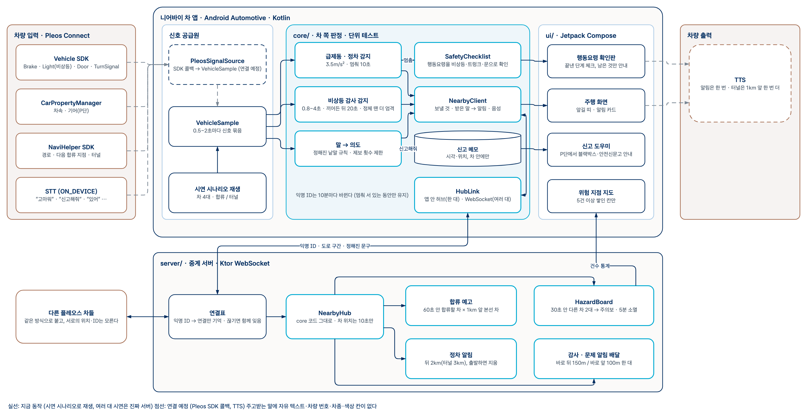

<sub>diagrams.net으로 그렸다. 원본 <a href="docs/architecture.drawio">docs/architecture.drawio</a>는 <a href="https://app.diagrams.net">app.diagrams.net</a>에서 파일 › 열기로 바로 고칠 수 있다. 실선은 지금 동작, 점선은 연결 예정.</sub>

```text
core/    차와 서버가 함께 쓰는 판정 규칙·통신 형식 (Kotlin JVM, 안드로이드 의존 없음)
  Protocol.kt        차 ↔ 서버 메시지. 자유 텍스트·차량 번호·차종·색상 칸이 없다
  NearbyHub.kt       서버 판단: 합류 예고, 주의보 퍼뜨리기, 정차 알림(뒤차 답으로 유지·삭제), 감사·문제 배달
  HazardBoard.kt     주의보 판정(2대 규칙·5분 소멸)과 지도용 건수 통계
  Detectors.kt       급제동·정차·비상등 감사 감지 (정체 중 엄격 판정)
  SafetyChecklist.kt 2차 사고 행동요령을 차량 신호로 확인
  NearbyClient.kt    차 한 대: 신호 → 서버로 보낼 것, 서버 말 → 화면·음성, 지나간 뒤 질문
  Voice.kt           음성 의도(정해진 낱말 규칙)와 제보 횟수 제한
  demo/              시연 시나리오 2편과 재생기
server/  Ktor WebSocket 중계 서버. 판단은 core에 맡기고 연결만 관리
app/     Pleos Connect 앱 (Jetpack Compose)
```

`NearbyHub`를 통신과 떼어 두어서, 같은 판단을 **앱 안(한 대 시연)** 과 **진짜 서버(여러 대 시연)** 에서 그대로 돌린다.

### 쓰는 Pleos SDK

공모전에서 쓸 수 있는 SDK 5종만 쓴다.

| SDK | 쓰는 곳 |
| --- | --- |
| Vehicle | 속도, 브레이크, 깜빡이, 비상등, 트렁크·문, 기어 → `VehicleSample` |
| NaviHelper | 경로상 다음 합류 지점과 도착 예정 시간, 터널 구간 |
| FusedLocation | 도로 위 위치를 200m 구간으로 맞추기 |
| TTS | 알림 문장 읽기 |
| STT | SpeechToText **ON_DEVICE**만. 정해진 낱말(고마워·신고해줘·있어·없어·응 등)만 읽는다 |

향후 계획(지금은 쓰지 않음): Gleo AI LLM으로 자유로운 말을 의도로 바꾸기, Sync SDK로 차끼리 공유가 되는지 확인(안 되면 지금 서버 유지).

## 실행

### 한 대 시연 (에뮬레이터 1대)

APK를 설치하고 실행한 뒤 **시연 1 합류** 또는 **시연 2 터널**을 고르고 **재생**. 아래 **차 A~D**를 누르면 같은 순간을 다른 차의 화면으로 본다. 시연 2가 끝나면 **5분 뒤로**로 주의보가 사라지는 걸 보고, **위험 지점 지도**를 연다.

### 여러 대 시연 (에뮬레이터 여러 대 + 내 PC 서버)

```bash
NEARBY_DEMO=1 ./gradlew :server:run          # ws://localhost:8080/nearby
```

에뮬레이터마다 **여러 대 시연**을 켜고 맡을 차(A~D)를 고른 뒤 함께 **재생**한다. 에뮬레이터는 `10.0.2.2:8080`으로 PC 서버에 붙는다(주소는 `app/build.gradle.kts`의 `HUB_URL`).

### 원하는 장면에서 바로 열기 (화면 캡처·영상용)

```bash
adb shell am start -S -n com.botdue.nearby/.MainActivity --ei scenario 1 --es car D --ei seek 12 --ez clean true
# --ei scenario 0|1  시연 1 합류 / 시연 2 터널,  --es car A~D  보는 차,  --ei seek 초  그 시점까지 감아 두기
# --ez clean true  시연 조작판 숨기기 (차 안 목업·캡처용)
# --ez map true --ez jump true  위험 지점 지도, 5분 뒤 상태
# --ez play true  열자마자 재생 (영상 녹화용)
```

| 장면 | 명령 끝에 붙일 값 |
| --- | --- |
| 합류 예고 (B) | `--ei scenario 0 --es car B --ei seek 20` |
| 감사 인사 (B) | `--ei scenario 0 --es car B --ei seek 50` |
| 문제 알림 (A) | `--ei scenario 0 --es car A --ei seek 58` |
| 앞길 주의보 (D) | `--ei scenario 1 --es car D --ei seek 12` |
| 행동요령 확인 (C) | `--ei scenario 1 --es car C --ei seek 35` |
| 터널 앞 재안내 (D) | `--ei scenario 1 --es car D --ei seek 62` |
| 후방 주의 (A) | `--ei scenario 1 --es car A --ei seek 10` |
| 신고 도우미 (B, 주차 후) | `--ei scenario 1 --es car B --ei seek 78` |
| 멈춘 차 500m 재안내 (D) | `--ei scenario 1 --es car D --ei seek 82` |
| 지나간 뒤 질문 (D) | `--ei scenario 1 --es car D --ei seek 114` |
| 신고 번호 (D) | `--ei scenario 1 --es car D --ei seek 121` |
| 위험 지점 지도 | `--ei scenario 1 --ei seek 125 --ez map true --ez jump true` |

이미 떠 있는 앱에 다시 `am start`를 보내도 새 값으로 처음부터 다시 만든다(`-S`는 확실하게 하려고 붙인다).

## 테스트 환경

| 항목 | 내용 |
| --- | --- |
| 테스트 기기 | **Pleos Connect Emulator v2.1.0** (Android 14 · API 34 Automotive, 시스템 이미지 "Pleos Connect v2.1.0 APIs" arm64, 빌드 `RELEASE.release_connect_v2.1.0`), Android Emulator 35.2.10, macOS (Apple Silicon) |
| 화면 규격 | AVD 프로필 Pleos Connect v2.1.0: **2560×1440, 160dpi(mdpi), 12.8인치**, RAM 4GB, Cold boot |
| 앱 창 | 세로 1칸 **841×1210dp** (Pleos 화면에서 x 853~1694, y 90~1300), 가로 2칸 **1706×1210dp**. 앱은 설계 기준 창(세로 613×887dp, 가로 1247×887dp)을 실제 창 크기에 맞춰 통째로 비례 확대한다 (`ui/Theme.kt`의 `FitWindow`) |
| 실행 확인 | release APK를 설치해 위 화면처럼 세로 1칸·가로 2칸에서 실행했다 ([Pleos 실제 화면](#pleos-connect-에뮬레이터에서-실제로-실행한-화면)) |
| 화면 이미지(docs/screens) | 개발 중에는 Android Emulator(API 35)를 `wm size 920x1414`·`wm density 240`으로 앱 창 크기(920×1330px)만 맞춰 찍었다 |
| 아직 안 한 것 | Vehicle·NaviHelper SDK 콜백 실연결 (지금 차량 신호는 시연용 데이터로 재생). 2차 PT 전에 Virtual Console(`adb forward tcp:8088 tcp:8088`)로 신호를 넣어 확인할 예정 |
| 빌드 | Android Studio, Kotlin(Jetpack Compose), minSdk 28, Gradle 8.13 |
| 중계 서버 | 내 PC에서 `NEARBY_DEMO=1 ./gradlew :server:run` (포트 8080, `PORT`로 바꿀 수 있다). 에뮬레이터는 `ws://10.0.2.2:8080/nearby`로 붙는다 |
| 판정 엔진 | `./gradlew :core:test :server:test` (JVM만 있으면 된다, 에뮬레이터 불필요) |

### 빌드와 테스트

```bash
./gradlew :core:test :server:test   # 테스트 43개
./gradlew :app:assembleRelease
```

## 현재 상태

| 항목 | 상태 |
| --- | --- |
| 판정 엔진(core) | 완료, 테스트 42개 (규칙별 + 차 한 대 흐름 + 시나리오 처음부터 끝까지) |
| 중계 서버 | 완료, WebSocket 두 연결 간 배달 테스트 1개. 에뮬레이터 앱 ↔ PC 서버 ↔ 다른 차(스크립트) 합류 예고 오가는 것 확인 |
| 시연 영상 | v9(83초, v0.3.0 화면). 뒤차 500m 재안내·지나간 뒤 확인·신고 번호 장면 포함 (`docs/demo.mp4`) |
| 디자인 | v0.3.0: 주행 중 표 숨김·큰 거리 숫자, 자막 거리 맞춤, 램프 눈금 5줄 간격. 그 밖은 v0.2.0. 현대차 "Pixel by Pixel" 캠페인에서 출발한 앞길 램프, 밝은 도로 바탕과 표지판처럼 읽히는 알림으로 다른 세 앱과 화면 문법을 나눔 ([디자인](#디자인)) |
| 차량 앱 화면 | 완료 (주행·행동요령·신고 도우미·질문·신고 번호·지도). Pleos Connect Emulator v2.1.0에서 release APK 실행 확인([Pleos 실제 화면](#pleos-connect-에뮬레이터에서-실제로-실행한-화면)). SDK 콜백 실연결은 아직 |
| Pleos SDK 연결 | 예정. `VehicleSample`을 Vehicle SDK(속도·Brake·TurnSignal·Light·Door·기어), NaviHelper(경로·합류 지점·터널), FusedLocation 콜백으로 채운다 |
| 음성 | 예정. 낱말 규칙(`KeywordIntentReader`)은 그대로 두고, 입력만 SpeechToText(ON_DEVICE)로 받는다. 읽기는 TTS |
| 확인할 것 | NaviHelper로 다음 합류 지점 받기, 비상등·기어 상태 읽기, 급제동 기준값 |
| 향후 계획 | Gleo AI LLM(자유로운 말 이해), Sync SDK(차끼리 공유 가능 여부). 지금은 쓰지 않는다 |

## 지키는 원칙

- 판단은 운전자가 한다. 니어바이는 "참고 정보"만 준다.
- 알림은 한 번, 짧고 차분하게. 터널 1km 앞·멈춘 차 500m 앞 재안내와 지나간 뒤 질문 한 번만 예외.
- 차를 멈추라고 하지 않는다. 속도를 줄이라고만 한다.
- 특정 차·사람을 기억하지 않는다. 순간과 장소만, 5분 동안.
- 신고 판단은 경찰이 한다. 앱은 시각·위치 메모와 절차 안내만.

## 근거

| 내용 | 출처 |
| --- | --- |
| 고속도로 2차 사고 치사율 48.3%(전체 사고의 약 5배), 터널 사고 5.5% 증가, 2021~2025 | [인사이트](https://www.insight.co.kr/news/539886), [헤럴드경제 2026.07](https://www.heraldk.com/article/2026070714003108803) |
| 터널 사고 3대 이상 연쇄 추돌 44.9% (전체 고속도로 35.5%), 2021~2025 | [SBS Biz (한국도로공사 자료)](https://biz.sbs.co.kr/amp/article/20000334257) |
| 보복운전 검찰 송치 2022년 1,570건 → 2025년 1,726건 | [다음 뉴스](https://v.daum.net/v/Bl0WyJXSHP) |
| 티맵 V2X 급정거·갓길 정차 알림, 사고포착알리미 | [SKT 뉴스룸](https://news.sktelecom.com/132635), [스포츠경향 2021.05](https://sports.khan.co.kr/article/202105241416013) |
| 비상등 패턴을 뒤차에 전하는 연구(앱 없음) | [koreascience](https://koreascience.or.kr/article/JAKO202018955008656.page) |
| 협력 차선 변경·합류 표준화(전용 V2X 칩 필요) | [ETSI TR 103 578](https://www.etsi.org/deliver/etsi_tr/103500_103599/103578/02.01.01_60/tr_103578v020101p.pdf) |

---

<sub>팀 봇듀 · 2026 현대자동차그룹 차량용 앱 개발 공모전</sub>
